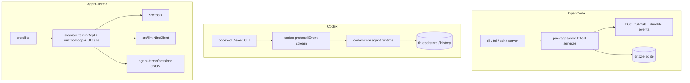

# Architecture Comparison — OpenCode vs Codex vs Agent-Termo

> Source-backed comparison. This document records the exact reference sources
> examined and cites real file paths for every important claim. It compares the
> ACTUAL Agent-Termo code as of `local-branch` (HEAD `ec7e8c0`), not an aspirational
> design.

## Research status

| Repository | URL | Branch | Commit SHA (examined) | Clone method | Notes |
|---|---|---|---|---|---|
| OpenCode | https://github.com/anomalyco/opencode | `main` | `609e4bb6aed2fbd6628910861aef54e8b2e9f712` | `git clone --depth 1` | Clean checkout. |
| OpenAI Codex | https://github.com/openai/codex | `main` | `a1604a8c0554c09c1be45e5a121bb1889b4d9a50` | `git clone --depth 1` | Clone succeeded; initial checkout failed on Windows because some snapshot file names exceed `MAX_PATH`. Fixed with `git config core.longpaths true` + `git checkout -- .`. |
| Agent-Termo | (this repo) | `local-branch` | `ec7e8c0` | — | Live source, read directly. |

Clone location (outside the repo): `K:/Computer Science/agent-termo-main-folder/local-agent-termo/.refs/{opencode,codex}`.

Citation keys used below:

- `[OC]` = OpenCode repo at `609e4bb` (paths relative to `packages/` where noted).
- `[CX]` = Codex repo at `a1604a8` (paths relative to `codex-rs/` where noted).
- `[AT]` = Agent-Termo at `ec7e8c0` (paths relative to `src/`).

Official documentation also consulted:

- https://openai.com/index/unrolling-the-codex-agent-loop/
- https://openai.com/index/unlocking-the-codex-harness/
- https://opencode.ai/docs/
- Codex in-repo docs: `codex-rs/docs/{exec.md, execpolicy.md, sandbox.md, skills.md, config.md}` `[CX]`

---

## Overall architecture

**OpenCode** is a TypeScript monorepo whose runtime is an Effect.TS
dependency-injection service graph. Every subsystem (`Agent`, `Session`,
`SessionRunner`, `SessionCompaction`, `Provider`, `Tool`, `Permission`, `Bus`,
`Database`) is a `Context.Service` with a `Layer` and a `makeLocationNode`
composing its dependencies — see `packages/core/src/agent.ts`,
`packages/core/src/session/session.ts`, `packages/core/src/session/runner/llm.ts`
`[OC]`. The runtime (`packages/core`) is client-agnostic; `cli`, `tui`, `sdk`,
`server`, `desktop` are separate consumers of the same core events/API
`[OC]` (`packages/core/src/session/event.ts`, `packages/core/src/bus.ts`).

**Codex** is a Rust workspace (`codex-rs/`, ~100 crates) with a strict
client/server split: `codex-core` owns the agent runtime and emits typed
`codex_protocol::protocol::Event`/`EventMsg` messages; the CLI
(`codex-rs/exec`, thin `codex-cli` npm wrapper) is an `EventProcessor` that
renders those events as human text or JSONL — see
`codex-rs/exec/src/main.rs`, `codex-rs/exec/src/event_processor.rs`,
`codex-rs/exec/src/event_processor_with_{human_output,jsonl_output}.rs` `[CX]`.
The same engine is reused by app-server / IDE clients
(`codex-rs/app-server*`, `codex-rs/code-mode-*`).

**Agent-Termo** is a single-process TypeScript CLI where the presentation and the
agent loop live in the same module. `src/main.ts` (2,595 lines) contains the REPL
(`runRepl`), the tool loop (`runToolLoop`), delegation, retry, and the UI calls
together. The UI (`src/ui/`) is invoked as plain functions rather than consuming a
runtime event stream.

**Takeaway:** OpenCode and Codex both separate a presentation-agnostic runtime from
the client and expose a typed event/protocol contract; Agent-Termo couples them in
`main.ts`.

---

## Comparison matrix

| Dimension | OpenCode `[OC]` | Codex `[CX]` | Agent-Termo `[AT]` |
|---|---|---|---|
| **Overall architecture** | Effect.TS service graph; core runtime is client-agnostic (`packages/core/src/*.ts` service + `Layer` + node). | Rust workspace; `codex-core` runtime emits `codex-protocol` events consumed by CLI/IDE/app-server clients. | Single TS process; `cli.ts` → `main.ts` where REPL, loop and UI are one module. |
| **Runtime initialization** | Services built once in host `Scope` (`Session.make` in `session/session.ts`); nodes compose deps via `makeLocationNode`. | `codex-rs/exec/src/main.rs` → `codex_exec::run_main`; session startup + prewarm + daemon recovery (`session/startup.rs`, `session/daemon_recovery.rs`, `thread_manager/`). | `runRepl` in `main.ts` constructs `NimClient`, loads session/agents/MCP, wires terminal hooks, then enters the input loop. |
| **Agent loop** | `SessionRunner.drain` (one fiber per session) → `SessionStep.attempt` per step; inbox drives the doorbell (`session/runner/llm.ts`, `session/runner/step.ts`, `session/run-coordinator.ts`). | `session/turn.rs::run_turn` loop → `run_sampling_request`; per-iteration `capture_step_context_with_required_mcp_servers`; pending input queue (`session/input_queue.rs`). | `runToolLoop` while-loop in `main.ts`: stream, `dedup`, execute sequentially (delegations parallel), append tool results, repeat until no tool calls or a budget/pause fires. |
| **Provider abstraction** | `provider.ts` builtin map (100+ providers) + AISDK adapters + dynamic module import; `model.ts`/`model-resolver.ts`. | `client.rs` (ModelClient) + `codex-model-provider` crate (`SharedModelProvider`) + `responses-api-proxy`; `model-provider-info`, `models-manager`. | `NimClient` (`llm/client.ts`) wraps the OpenAI SDK for all providers; `llm/providers.ts` holds 13 `BUILTIN_PROVIDERS`; a bespoke Anthropic fetch path in the same class. |
| **Streaming architecture** | `LLMClient.stream` in `@opencode/ai/effect`; `session/model-transport.ts` owns transport; step consumes events and publishes via Bus. | `client.rs` streams `ResponseItem`s; `stream_events_utils.rs`, `responses_metadata.rs`; event deltas emitted as protocol events. | `NimClient.streamComplete` (async generator) accumulates `ToolCallStreamAccumulator` deltas and text; UI is pushed via `onChunk` callbacks. |
| **Tool execution** | `tool/tool.ts` registry + `tool/runtime.ts` (schema decode/encode at the boundary); tools run as parallel fibers per step (`runner/step.ts`). | `tools/router.rs` (registry + exposure modes direct/deferred/code_mode_only/hidden + namespaces) and `tools/orchestrator.rs` (approval + sandbox + retry); handlers under `tools/handlers/`. | `TOOL_DEFINITIONS` (`llm/tools.ts`) describe; `executeTool` (`tools/index.ts`) routes a `TOOL_MAP` of plain functions. |
| **Tool-calling reliability** | Unsettled tools are failed explicitly (`failUnsettledTools(RESULT_MISSING)`), stale tool calls are settled on startup (`settleStaleToolCalls`), retries via `SessionRunnerRetry`. | Dedup/replay tracking (`tools/executed_tool_calls/`), native tool review (`tools/spec_plan.rs`), sandbox-denial retry (`tools/orchestrator.rs`), dispatch trace (`tools/tool_dispatch_trace.rs`). | `dedup` for reused call IDs, `ToolCallStreamAccumulator` for fragment assembly, text-JSON fallback parser `parseToolCallsFromText`, signature-keyed failure budget (see audit). |
| **Session management** | `Session` service with prompt/inbox/compaction/interrupt/revert; messages/history as durable rows (`session/session.ts`, `session/inbox.ts`, `session/history.ts`). | `Session` struct: at most 1 running task, `active_turn`, `input_queue`, settings persistence semaphore (`session/session.rs`); `thread_manager/` owns thread lifetime. | `StoredSession` JSON files under `.agent-termo/sessions` (`runtime/sessions.ts`); `TaskState` keeps goal/status/lastActions/failedToolCalls in memory and persisted. |
| **Context management** | `session/compaction.ts`: auto/overflow/manual triggers, background summary precompute, `SHRINK_STEPS [0.85,0.7,0.5,0.35]` on overflow, verbatim tail (`keepID`) beside a summary. | `compact.rs` + `compact_token_budget.rs` + `compact_remote_v2.rs` + `auto_compact_window.rs`; pre-turn auto-compact, token-budget compaction installs a fresh context window, pre/post compact hooks. | `runtime/context.ts`: reserved input-budget trigger, deterministic `collectProtectedMessages`, `shortenToolMessages`, aggressive recovery in `completeWithContextRecovery` (see audit). |
| **Persistence** | drizzle SQLite (`database/`, `sqlite.bun|node|workerd`) with generated schema + migrations; events are durable with seq/aggregateID (`bus.ts`, `event/sql.ts`). | `thread-store` + `history` crates, `state_db_bridge.rs`, `thread_store_builder.rs`, `turn_metadata.rs`; conversation/rollout reconstruction (`session/rollout_reconstruction.rs`). | JSON files: `sessions/*.json` (atomic tmp+rename), `*.archive.jsonl` for compacted messages, `docs/MEMORY.md`/`docs/TIMELINE.md` as project memory. |
| **Process management** | `shell/`, `pty/`, `persistent-pty/`, `snapshot.ts` (file snapshots), `tool-output.ts` truncation. | `exec.rs` (output caps ~1 MiB, timeout, `CancellationToken`, process-group kill), `unified_exec/` (process manager, command sessions, PTY), `spawn.rs`. | `runtime/terminal-sessions.ts` (background sessions, event-driven `bash:read`, process-tree kill) + `tools/index.ts` foreground spawn with live hooks. |
| **Permissions/security** | `permission.ts`: rule-based `Ruleset` (action/resource/effect + wildcard), saved permissions, `BlockedError`/`DeclinedError`/`CorrectedError`; `file-access.ts`, `file-write.ts`. | `exec_policy.rs` (policy files, banned prefixes, model allow-prefix rules), `execpolicy`/`execpolicy-rules` crates, `codex-sandboxing` (landlock/bwrap/Windows restricted token), network policy, Guardian review. | `runtime/permissions.ts` (allowed-commands allowlist persisted to `permissions.json`), `runtime/workspace.ts` path containment with symlink check, prompt-based command approval in `main.ts`. |
| **Cancellation** | `Session.interrupt` → `run-coordinator.interrupt` (fiber interrupt + doorbell); `SessionStep` cooperative stop (5 s) then interrupt tools. | `CancellationToken` threaded through `run_turn`, `exec`, `unified_exec`; `turn_suspension.rs`, `sampling_interrupt.rs`; thread-manager drop cancellation. | `withEscapeCancellation` races input keys against the request and aborts via `AbortController`; `killRunningTerminal` on shutdown; no structured concurrency. |
| **Error recovery** | `session/to-session-error.ts`, `StepFailedError`, `SessionRunnerRetry`, output-limit continuation, stale compaction/tool settlement on restart. | `responses_retry.rs`, retry classification, `session_rollout_init_error.rs`, error lifecycle events, daemon recovery. | `isTransientError`/`withTransientRetries`, `completeWithContextRecovery` (one aggressive retry), non-streaming fallback, task paused for `continue` (see audit). |
| **Event system** | `bus.ts`: PubSub + durable DB-backed events with seq/aggregateID and versioned decode; typed `SessionEvent.*`. | `codex-protocol` `Event`/`EventMsg` client-server protocol; `EventProcessor` trait renders human/JSONL; `event_mapping.rs`. | No central event bus. UI is called directly (`print*`, `setScreenStatus`); the sub-agent monitor (`runtime/subagents.ts`) has its own subscribe API; timeline is appended to files. |
| **Plugin/extensibility** | `plugin/` (host, hooks, sdk, module, provider/agent/skill/command plugins), `integration.ts`, `skill.ts`. | `codex-plugin`/`plugin-host`/`core-plugins` crates, `skills.rs`, `agents_md.rs`, hook runtime (`hook_runtime.rs`, `hook_mcp_executor.rs`). | Markdown agents/commands/skills loaded from `.agent-termo/` (`runtime/agent-folder.ts`, `runtime/skills.ts`); no in-process plugin host. |
| **MCP** | `mcp/` (client, stdio, socket, event-stream, oauth, pool, instructions). | `mcp.rs`, `mcp_tool_call.rs`, `session/mcp*.rs` (prewarm/refresh/runtime), `codex-mcp` crate, `rmcp-client`. | `runtime/mcp.ts`: stdio + streamable-HTTP servers, tool discovery, `mcp_*` tool names with per-call approval. |
| **Observability** | OpenTelemetry span annotations (`runner/step.ts`), usage/cost recording (`session/usage.ts`), durable event log. | `codex-otel` crate, `otel_init.rs`, `trace_span!` in turn loop, `turn_metrics.rs`, `turn_timing/`, token-usage records. | `NimClient.formatUsage()` token counter (estimated, calibrated against provider usage in `context.ts`), spinner/status bar, file-based timeline. |
| **Testing** | Colocated unit tests across packages + dedicated `simulation` package (`packages/simulation`). | Extensive colocated `*_tests.rs` (e.g. `agent/control_tests.rs`, `session/turn_tests.rs`, `exec_policy_tests.rs`, `unified_exec/*_tests.rs`). | Vitest `tests/unit/*` + `tests/integration/*`; 215 passed / 2 skipped (see audit & plan). |

---

## What the references do that Agent-Termo does not (highest-impact gaps)

1. **Presentation/runtime separation with a typed event contract.** OpenCode's
   `Bus` + `SessionEvent.*` `[OC]` and Codex's `codex-protocol` + `EventProcessor`
   `[CX]` let any client reconstruct the execution timeline. Agent-Termo calls UI
   functions directly from `main.ts` and has no event envelope `[AT]`.

2. **Structured concurrency / per-session execution ownership.** OpenCode's
   `run-coordinator.ts` serializes execution per session key with a doorbell and
   fibers `[OC]`; Codex's `Session` permits at most one running task and threads a
   `CancellationToken` everywhere `[CX]`. Agent-Termo has a single in-flight task
   guarded only by module-level state and an `AbortController` `[AT]`.

3. **Rule-based permission model + real sandboxing.** OpenCode evaluates a
   wildcard `Ruleset` (action/resource/effect) `[OC]`; Codex combines `.rules`
   policy files with OS-level sandboxes (landlock/bwrap/restricted token)
   `[CX]`. Agent-Termo uses a persisted command allowlist plus a prompt, and
   explicitly does not claim OS isolation `[AT]`.

4. **Durable, versioned persistence with migration.** OpenCode stores sessions and
   events in drizzle SQLite with generated migrations `[OC]`; Codex has a dedicated
   `thread-store`/`history` with rollout reconstruction `[CX]`. Agent-Termo uses
   unversioned JSON files with a defensive parser but no schema migration `[AT]`.

5. **Compaction with a verbatim tail + summary and shrink-on-overflow.** OpenCode
   keeps recent messages verbatim (`keepID`) beside a background-summarized prefix
   and shrinks in steps on provider overflow `[OC]`; Codex distinguishes auto
   (token-budget window reset) from model/server summarization and runs pre/post
   compaction hooks `[CX]`. Agent-Termo's `collectProtectedMessages` approximates
   the "verbatim tail" idea deterministically but has no summarization model pass
   and no shrink-step ladder `[AT]`.

## Where Agent-Termo is already comparable

- **Provider breadth for a CLI**: 13 built-in providers plus custom OpenAI
  endpoints and a native Anthropic path (`llm/providers.ts`, `llm/client.ts`) `[AT]`
  is more than a minimal single-provider CLI.
- **Deterministic, unit-testable context compaction** with explicit protection of
  the system prompt, objective, current goal, latest tool result, and
  `Status: failure` diagnostics (`runtime/context.ts`) `[AT]` — a property the
  references achieve with more machinery (summarizer models, background fibers).
- **Bounded tool retries with a signature-keyed budget** (`MAX_CONSECUTIVE_FAILURES_PER_SIGNATURE`
  and the corrective-action clear rule in `main.ts`) `[AT]` — comparable in intent
  to Codex's sandbox-denial retry and OpenCode's `SessionRunnerRetry`.
- **Process-tree termination** (`runtime/terminal-sessions.ts` uses `taskkill /t /f`
  on Windows and group kill on POSIX) `[AT]` — mirrors Codex's process-group kill in
  `exec.rs` `[CX]`.
