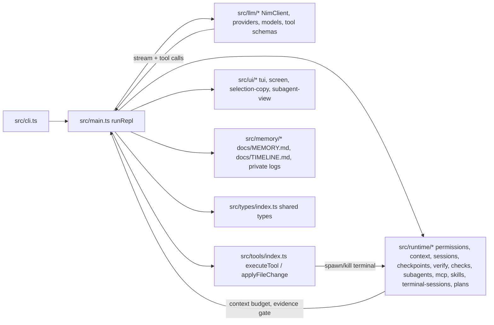
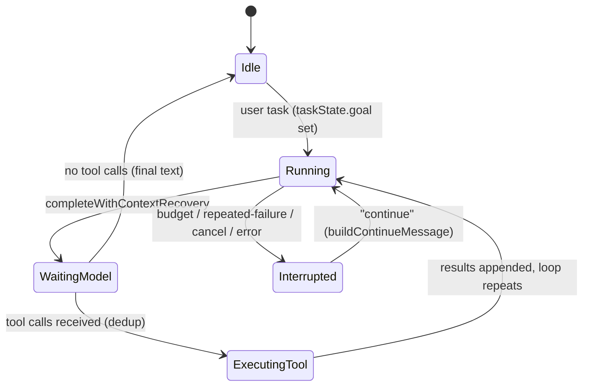

# Current Architecture Audit — Agent-Termo

> Audited against `local-branch` HEAD `ec7e8c0`. Everything below reflects the
> actual code in `src/`, not the aspirational target (see
> `target-architecture.md` for the gap analysis).
>
> Static component/tech-stack/directory-structure reference is covered by
> `docs/architecture.md` (singular); this audit focuses on the live code and
> findings, and deliberately does not duplicate that document.

## Entry points and execution flow

- `bin/agent-termo.js` → `dist/cli.js` (built by `scripts/build.mjs`).
- `src/cli.ts` — commander CLI. Parses args, `init`, `mcp` subcommands, API-key
  prompt, then calls `runRepl`. `-y/--auto-approve` and `--model` map to env vars
  before `main.ts` initializes.
- `src/main.ts` — the live runtime. `runRepl` is the REPL; `runToolLoop` is the
  agent loop. Both the orchestration and the UI calls live here (2,595 lines).



## Module ownership (actual)

| Module | Owns | Key exports |
|---|---|---|
| `src/cli.ts` | argument parsing, provider-key bootstrap, `init`/`mcp` subcommands | `main()` → `runRepl` |
| `src/main.ts` | REPL, tool loop, delegation, retry/error classification, task state, approval flow | `runRepl`, `runToolLoop`, `completeWithContextRecovery`, `completeWithRetry`, `withTransientRetries`, `isTransientError`, `shouldPauseForRepeatedFailedToolCall`, `shouldClearFailedToolCalls`, `toolCallSignature`, `formatToolResultForModel`, `finishTaskState` |
| `src/llm/client.ts` | provider client (OpenAI SDK + Anthropic fetch), streaming, tool-call fragment assembly, text-JSON fallback parsing, token usage | `NimClient`, `ToolCallStreamAccumulator`, `parseToolCallsFromText`, `toWireToolName`, `fromWireToolName` |
| `src/llm/providers.ts` | provider catalogue | `BUILTIN_PROVIDERS`, `getProviderDefinition` |
| `src/llm/models.ts` | NVIDIA model catalogue + per-model context/output limits | `NVIDIA_NIM_MODEL_LIMITS`, `getProviderModelLimits`, `mergeModels` |
| `src/llm/tools.ts` | tool schemas exposed to the model | `TOOL_DEFINITIONS` |
| `src/tools/index.ts` | tool implementations (file/bash/git/browser/skill/memory), change proposal + apply, terminal hooks, cache invalidation | `executeTool`, `applyFileChange`, `setTerminalHooks`, `killRunningTerminal` |
| `src/runtime/context.ts` | context budget, estimation, compaction, tool-message shortening, context-error detection | `resolveContextBudget`, `estimateContextTokens`, `prepareConversationForRequest`, `compactConversation`, `isContextWindowError`, `recordContextTokenUsage` |
| `src/runtime/run-budget.ts` | wall-clock tool-loop budget | `TOOL_LOOP_TIME_BUDGET_MS` (20 min), `getToolLoopStopReason` |
| `src/runtime/permissions.ts` | command allowlist persistence + which tools require approval | `loadAllowedCommands`, `isCommandApprovalRequired`, `commandApprovalKey` |
| `src/runtime/sessions.ts` | session JSON persistence, archive, history search, fork | `createSession`, `saveSession`, `loadSession`, `appendSessionArchive`, `searchSessionHistory` |
| `src/runtime/terminal-sessions.ts` | background terminal sessions + process-tree termination | `startTerminalSession`, `waitForTerminalSession`, `stopTerminalSession`, `terminateProcessTree`, `stopAllTerminalSessions` |
| `src/runtime/verify.ts` / `checks.ts` | evidence-gated completion | `verifyCompletionWithChecks`, `runProjectChecks` |
| `src/runtime/checkpoints.ts` | file snapshots for undo/redo | `createCheckpoint`, `recordCheckpointBefore/After`, `undoCheckpoint` |
| `src/runtime/subagents.ts` | sub-agent monitor registry + subscription | `spawnSubAgent`, `finishSubAgent`, `subscribeSubAgents` |
| `src/runtime/mcp.ts` | MCP server lifecycle + `mcp_*` tool execution | `initializeMcpServers`, `getMcpToolDefinitions`, `executeMcpTool`, `shutdownMcpServers` |
| `src/runtime/skills.ts` | skill catalog/instructions | `listSkills`, `readSkillFile`, `loadSkillCatalogPrompt` |
| `src/runtime/plans.ts` | task-plan parse/render/step update | `parseTaskPlan`, `updatePlanStep`, `buildPlanContext` |
| `src/runtime/workspace.ts` | path containment (lexical + realpath) | `isPathWithinWorkspace` |
| `src/memory/index.ts` | project MEMORY/TIMELINE + private session/runtime logs | `loadMemory`, `appendToTimeline`, `logAgentTermoTimeline` |
| `src/agents/index.ts` | agent loading + system-prompt builder + tool filtering | `loadAllAgents`, `buildSystemPrompt`, `filterAgentTools`, `resolveDelegation` |
| `src/types/index.ts` | shared types | `ConversationMessage`, `ToolCall`, `ToolResult`, `PermissionMode`, `Session`, `ToolDef` |
| `src/ui/*` | rendering (TUI, markdown, selection/copy, sub-agent view) | `print*`, `promptAcceptReject`, `promptCommandApproval`, `initScreen`, `MarkdownPrinter` |
| `src/diff/index.ts` | file diff computation | `computeDiff` |
| `src/utils/*` | config, shell resolution, ANSI | `getConfig`, `resolveShell`, `resolveProjectRoot` |

## Execution lifecycle (model/tool cycle)



1. `runRepl` loads config, custom agents/commands, MCP servers, the latest
   persisted session, and builds the system prompt (`buildSessionPrompt`).
2. On a task, the first model call streams via `completeWithContextRecovery`;
   tool calls are `dedup`ed.
3. `runToolLoop` executes tool calls: all `agent:delegate` calls in parallel
   (`shouldRunDelegationsInParallel`), everything else sequential to avoid
   write/terminal races.
4. Results are serialized with `formatToolResultForModel` and appended as
   assistant→tool message pairs (OpenAI ordering).
5. The loop repeats until the model emits no tool calls. Termination conditions:
   the 20-minute wall-clock budget (`runtime/run-budget.ts`), the
   signature-keyed failure budget (repeated-failure pause), user cancel, or a
   provider error. Model-turn count is NOT a stopping condition.
6. Completion for code work is gated by `verifyCompletionWithChecks` against real
   evidence (files written, check commands run) — not the model's narration.

## Root-cause findings

### The three just-fixed bugs (commits `27f48c9` + `ec7e8c0`)

**Bug 1 — Context auto-compaction fired too early and could drop critical context.**
`src/runtime/context.ts`.

- Observed: conversations were compacted well before the context window was
  actually at risk, and the summary could lose the original objective, the latest
  goal, the most recent tool result, or a failure diagnostic.
- Root cause: `prepareConversationForRequest` triggered compaction at 0.85 of a
  budget whose `inputBudgetTokens` already reserves output and safety margin — so
  it compacted at ~0.85×(window−output−margin), far under the real limit.
  Protection was ad-hoc, not deterministic.
- Fix (current code):
  - The trigger is now the reserved input budget: `const trigger = budget.inputBudgetTokens;`
    (lines 272–275). It compacts only when the estimated input would exceed that
    budget; the aggressive recovery path targets 0.68 of it.
  - `collectProtectedMessages` (lines 160–175) deterministically protects, by
    role/order/marker only: the system prompt (first `system`), the original
    objective (first `user`), the current goal (latest `user`), the most recent
    tool result (latest `tool`), and every tool message containing
    `Status: failure` (the marker emitted by `formatToolResultForModel` in
    `main.ts`).
  - `makeCompactionSnapshot` keeps protected messages verbatim in the retained
    conversation instead of folding them into the summary (lines 195–198, 221).
  - `shortenToolMessages` skips protected messages (lines 246–257).
  - `completeWithContextRecovery` (in `main.ts`, lines 278–316) retains the
    aggressive recovery path: on a detected context-window error it re-prepares
    with `{ aggressive: true }` and retries once.
- Verification: `tests/unit/context.test.ts` regressions — "does not compact when
  the estimate is under the reserved input budget (regression: premature 0.85
  trigger)", "compaction keeps the objective, current goal, and failed-call
  diagnostics verbatim", "produces identical results for two identical copies"
  (determinism), plus budget-trigger, oversized-request, and tool-shortening tests.

**Bug 2 — Tool loop bounds.** `src/main.ts` + `src/runtime/run-budget.ts`.

- Observed: unclear/incorrect stopping conditions; the loop could look like it ran
  forever or stop for the wrong reason.
- Root cause: symptom of (1) (premature compaction) and (3) (unbounded retries).
  The only legitimate hard bound is wall-clock time.
- Fix (current code): bounds are exactly (a) the 20-minute wall-clock budget in
  `runtime/run-budget.ts` (`TOOL_LOOP_TIME_BUDGET_MS = 20 * 60 * 1000`,
  `getToolLoopStopReason`), (b) the retry budget (Bug 3), and (c) loop termination
  when the model stops issuing tool calls (`while (toolCalls.length > 0)`). On
  budget stop, pending calls are preserved as explicit assistant/tool failures and
  the task is marked `interrupted` for "continue" (`runToolLoop` lines 864–890).
- Verification: `tests/unit/tool-loop-budget.test.ts` asserts no model-turn count
  is used and the wall-clock budget still stops a run.

**Bug 3 — Retry gate.** `src/main.ts`.

- Observed: the same failing tool call could be re-attempted indefinitely, and the
  failure memory was shared with diagnostic state.
- Root cause: the pause check counted failures across the whole task and shared a
  single `Set` between the gate and diagnostics.
- Fix (current code):
  - `MAX_CONSECUTIVE_FAILURES_PER_SIGNATURE = 2` (line 207): one genuine retry is
    allowed; a second consecutive failure reaches the budget.
  - `shouldPauseForRepeatedFailedToolCall(signature, failedToolCalls)` takes a
    `ReadonlyMap<string, number>` and blocks only at `count >= 2` (lines 214–219).
  - `runToolLoop` keeps a run-scoped `const failedToolCalls = new Map<string, number>()`
    (line 853); `taskState.failedToolCalls` remains a `Set<string>` for diagnostics
    only (line 855), surfaced in `buildContinueMessage`.
  - `shouldClearFailedToolCalls(toolName, success)` (lines 224–228) clears the run
    budget only after a successful non-read-only corrective action
    (`READ_ONLY_TOOL_CALLS` excludes `file:read`, `file:glob`, `grep`,
    `git:status`, `git:log`). A successful `file:write`/`bash:execute` therefore
    unblocks retrying a previously failed signature.
- Verification: `tests/unit/retry-budget.test.ts` (budget semantics, signature
  keying incl. JSON key-order stability, corrective-action clearing) and
  `tests/integration/tool-loop.test.ts` ("stops duplicate empty file writes…",
  "pauses instead of executing an unchanged failed call forever", "lets a
  previously failed call retry after a successful corrective write").

### Prior defects (already fixed in earlier commits)

| ID | Severity | Component | Problem | Fix | Verified |
|---|---|---|---|---|---|
| D1 | Critical | `src/main-new.ts`, `src/core/*` | Abandoned second runtime duplicated session/tool/LLM logic and lost streamed tool calls; nothing imported it. | Deleted 9 orphaned files. | typecheck + tests pass. |
| D2 | High | `PermissionMode` type | Defined in three places; TUI imported it from the dead `core/` tree. | Single `PermissionMode` in `src/types/index.ts`. | typecheck + permission-colors tests pass. |

### Remaining architectural weaknesses (not yet fixed — see target/plan)

1. `src/main.ts` mixes orchestration and presentation; the UI cannot reconstruct
   the timeline from events. (God-module risk.)
2. No central, typed event contract; UI is invoked via direct calls.
3. Concurrency is ad hoc: a single `activeBashChild`, a module-level approval
   queue, and per-request `AbortController` rather than structured cancellation.
4. Permissions are a persisted command allowlist + prompts, not a rule model and
   not OS-level isolation.
5. Session persistence is unversioned JSON with defensive parsing; no migration
   path for schema evolution.
6. Token usage is estimated (calibrated when a provider reports usage); the status
   bar shows `~N tokens` to signal estimation.
7. Cross-platform and live-provider behavior are unit-tested but not exercised
   against real endpoints or non-Windows hosts in this repo's CI.

## Test status (actual, this branch)

```
bun run test   →  Test Files  31 passed | 1 skipped (32)
                  Tests  215 passed | 2 skipped (217)
bun run typecheck → clean (exit 0)
```

See `docs/TESTING.md` for the regression-test matrix added with commit `ec7e8c0`.
