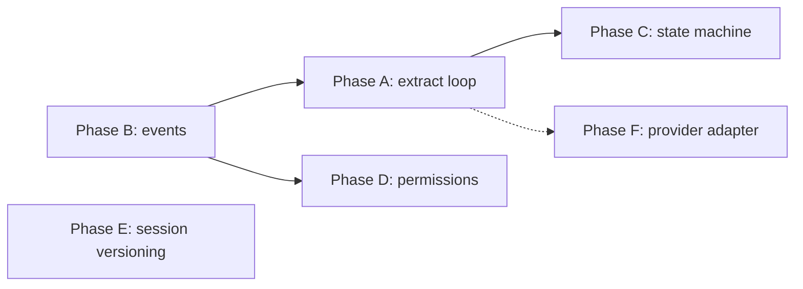

# Implementation Plan — Agent-Termo Architecture Remediation

> Aligned with reality on `local-branch` HEAD `ec7e8c0`. Completed work is real;
> outstanding work is sequenced but not yet started. This is a plan, not a
> completion report.

## Status snapshot (verified this session)

| Check | Result |
|---|---|
| `bun run typecheck` | clean (exit 0) |
| `bun run test` | **215 passed / 2 skipped** across **31 passed + 1 skipped test file (32 total)** |
| Reference research | OpenCode `609e4bb`, Codex `a1604a8` cloned and inspected (see `architecture-comparison.md`) |

## Completed work (already merged on `local-branch`)

### Stage 1 — three reliability bug fixes (`27f48c9`)

1. **Context auto-compaction trigger** — `src/runtime/context.ts`. Compaction now
   fires only when the estimated input exceeds the reserved `inputBudgetTokens`,
   not 0.85 of it; `collectProtectedMessages` deterministically protects the
   system prompt, original objective, current goal, most recent tool result, and
   `Status: failure` diagnostics; `shortenToolMessages` skips protected messages.
   Caller `completeWithContextRecovery` (`src/main.ts`) keeps the aggressive
   recovery path.
2. **Tool loop bounds** — `src/main.ts` + `src/runtime/run-budget.ts`. Bounds are
   the 20-minute wall-clock budget, the retry budget, and "model stops issuing
   tool calls"; on budget stop pending calls are preserved as explicit failures
   and the task becomes `interrupted`.
3. **Retry gate** — `src/main.ts`. `MAX_CONSECUTIVE_FAILURES_PER_SIGNATURE = 2`;
   `shouldPauseForRepeatedFailedToolCall` takes a run-scoped
   `Map<string, number>` and blocks at count ≥ 2; `taskState.failedToolCalls`
   stays a `Set` for diagnostics; `shouldClearFailedToolCalls` clears only after a
   successful non-read-only corrective action.

### Stage 2 — regression tests (`ec7e8c0`)

- `tests/unit/context.test.ts` — premature-0.85 regression, protected-marker
  verbatim regression, determinism regression, budget-trigger, oversized-request,
  tool-shortening.
- `tests/unit/retry-budget.test.ts` — budget semantics, signature keying (incl.
  JSON key-order stability), corrective-action clearing.
- `tests/unit/tool-loop-budget.test.ts` — no model-turn count; wall-clock stop.
- `tests/integration/tool-loop.test.ts` — failure→read/edit/re-verify flow,
  evidence-gate blocking, duplicate-call pause, unchanged-call pause, corrective
  retry. Plus `docs/TESTING.md`.

### Earlier (already in repo)

- D1: removed the orphaned second runtime (`src/main-new.ts`, `src/core/*`).
- D2: unified `PermissionMode` in `src/types/index.ts`.

## Outstanding work (phased)

### Phase A — extract the agent loop from the UI (priority: high)

- **Goal:** `runToolLoop` / `runDelegatedAgent` / `runRepl` in `src/main.ts`
  orchestrate without calling `print*`/`setScreenStatus` directly.
- **Dependencies:** define the event contract first (Phase B interface), otherwise
  the extraction has nothing to emit.
- **Test requirement:** loop integration tests continue to pass unchanged; UI
  tests keep passing; no new UI dependency inside `src/tools` or `src/runtime`.
- **Status:** not started.

### Phase B — typed event contract (`src/runtime/events.ts`) (priority: high)

- **Goal:** a small event envelope `{type, id, timestamp, sessionId, turnId?, payload}`
  with typed payloads; one-way runtime→UI.
- **Dependencies:** none; can land before Phase A.
- **Test requirement:** unit tests for emission ordering, no duplicate events, no
  listener leaks; invalid states must not emit.
- **Status:** not started. (Only `runtime/subagents.ts` has a subscribe API today.)

### Phase C — explicit execution state machine (priority: medium)

- **Goal:** name the states in `target-architecture.md` (Idle, WaitingForModel,
  StreamingResponse, ExecutingTool, AwaitingApproval, Completed, Interrupted) and
  validate transitions, replacing the coarse `TaskState.status` flags.
- **Dependencies:** Phase A/B (the loop must own transitions).
- **Test requirement:** transition table unit tests; illegal transitions rejected;
  cancellation from every state reaches a consistent state.
- **Status:** not started.

### Phase D — rule-based permissions + honest sandbox posture (priority: medium)

- **Goal:** keep the current allowlist/prompts working, add a small rule model
  (action/resource/effect) that all tools consult; continue to document that there
  is no OS-level sandbox.
- **Dependencies:** none hard; benefits from Phase B for permission events.
- **Test requirement:** rule precedence, wildcard matching, denial paths, persisted
  rules, no bypass via alternate tool paths.
- **Status:** not started.

### Phase E — session schema versioning + migration (priority: low)

- **Goal:** add a `schemaVersion` to `StoredSession` and a one-place decode/upgrade
  path (today: defensive `parseSession` in `runtime/sessions.ts`).
- **Dependencies:** none.
- **Test requirement:** old-format fixtures still load; unknown future versions
  fail loudly (not silently); migration idempotent.
- **Status:** not started.

### Phase F — provider adapter interface (priority: low)

- **Goal:** move the Anthropic-specific branch and OpenAI-specific quirks out of
  `NimClient` into explicit adapter objects while preserving all 13 providers and
  the custom endpoint.
- **Dependencies:** none; keep the current behavior contract.
- **Test requirement:** `providers.test.ts` and `streaming.test.ts` stay green;
  add an adapter contract test.
- **Status:** not started.

## Known risks

- **Live provider integration untested.** No API credentials in this environment;
  error classification and streaming are unit-tested only.
- **Cross-platform untested.** Only Windows was exercised; `terminal-sessions.ts`
  branches on `process.platform` but the POSIX path is unverified here.
- **Long-session stress untested.** Memory growth, orphaned processes over hours,
  and archive-file growth have not been measured.
- **Extraction regression risk (Phase A).** `runToolLoop` currently prints as it
  executes; moving output to events could silently change what users see if the
  event consumer is not feature-complete. Mitigation: keep the existing tests as
  the contract and land the event bus before removing direct UI calls.
- **No sandbox.** Approval is not isolation. The security docs must keep saying so
  (already stated in `target-architecture.md`).

## Ordering summary

Phases D, E, F are independent of A/C and can proceed in parallel with them.
