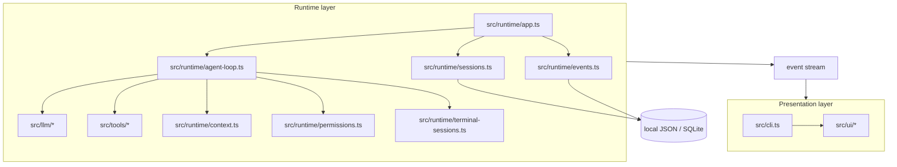
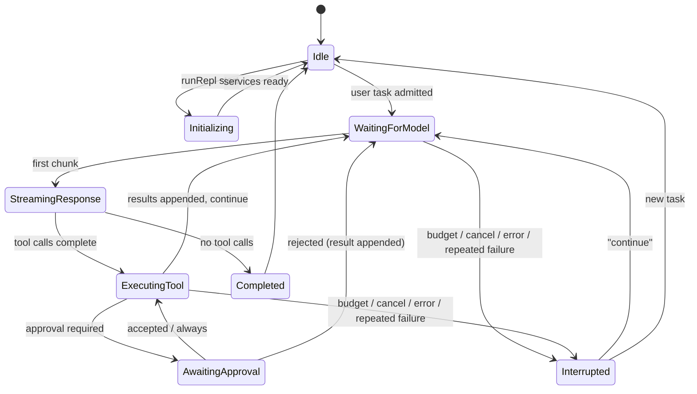
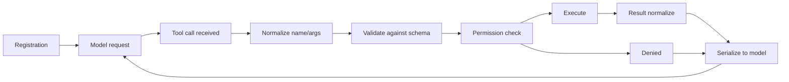

# Target Architecture — Agent-Termo

> Truthful gap analysis. Every item is marked against the ACTUAL code on
> `local-branch` HEAD `ec7e8c0`:
>
> - `implemented` — present and behaving as described in `src/`.
> - `partially implemented` — present but not at the target level of ownership/robustness.
> - `not yet implemented` — absent; a real gap, not a fiction.
>
> This document defines where the architecture should go; it does not claim the
> work is done. The design stays within Agent-Termo's existing stack (TypeScript,
> Node/Bun, OpenAI-compatible providers, local file persistence) and adds
> boundaries rather than frameworks.

## Design principles

1. One runtime, one owner per responsibility (`src/main.ts` must stop being the
   only coordinator that also talks to the UI).
2. Presentation consumes events; it never implements agent logic.
3. Provider-specific behavior is normalized at the adapter boundary.
4. Tool execution has one lifecycle and one permission boundary.
5. Sessions and task state have explicit owners and predictable transitions.
6. Cancellation propagates through every async boundary.
7. Context management is deterministic and independently testable (already true).

## Target module boundaries



| Boundary | Responsibility | Status |
|---|---|---|
| `src/runtime/app.ts` | composition root: build services, own lifecycle/shutdown | `partially implemented` — this is `runRepl` today, but it also renders UI. |
| `src/runtime/agent-loop.ts` | turn/tool loop as pure orchestration (no `print*`) | `partially implemented` — `runToolLoop` exists but calls UI directly. |
| `src/runtime/events.ts` | typed event stream: `AgentEvent` union + `AgentEventHub` (publish/subscribe) | `partially implemented` — six typed events (`turn.started`, `tool.started`, `tool.completed`, `usage.updated`, `context.updated`, `turn.completed`) are published from `runToolLoop`; the hub isolates listener errors and delivers one-way (runtime → UI). Not events yet: permission, assistant-delta, compaction, and process-exit; no persistence or replay. |
| `src/llm/*` | provider adapter + normalization | `implemented` for OpenAI-compatible + Anthropic; `partially implemented` for a formal adapter interface (provider conditionals live inside `NimClient`). |
| `src/tools/*` | tool registry + execution | `implemented` for execution; `partially implemented` for a validated registry (schemas live in `llm/tools.ts`, execution in `tools/index.ts`, no registration-time validation). |
| `src/runtime/context.ts` | budget/compaction | `implemented` (deterministic, tested). |
| `src/runtime/permissions.ts` | central permission decision | `partially implemented` — allowlist + prompts; no rule model, no sandbox. |
| `src/runtime/sessions.ts` | session ownership/persistence | `implemented` for JSON persistence; `partially implemented` for schema versioning/migrations. |
| `src/runtime/terminal-sessions.ts` | process lifecycle | `implemented` (process-tree kill, background sessions). |
| `src/ui/*` | rendering only | `partially implemented` — rendering is here, but the loop still calls it directly. |
| `src/runtime/agent-workspace.ts` | cross-agent workspace state, message dispatch, stop-all | `not yet implemented` — specified in `docs/ARCHITECTURE.md` §21 (Multi-agent Workspace). |
| `src/runtime/agent-tree.ts` | pure agent hierarchy + selection/window math | `not yet implemented` — specified in `docs/ARCHITECTURE.md` §21. |
| `src/runtime/agent-transcript.ts` | per-agent transcript store (conversation + tools + errors) | `not yet implemented` — specified in `docs/ARCHITECTURE.md` §21. |
| `src/runtime/agent-selection.ts` | selected-agent navigation state | `not yet implemented` — specified in `docs/ARCHITECTURE.md` §21. |

## Execution lifecycle / state machine

Target states (only the ones Agent-Termo genuinely needs):



| State | Where it exists today | Status |
|---|---|---|
| Idle / Running / Interrupted | `TaskState.status` in `main.ts` (`'idle' | 'running' | 'interrupted'`) | `implemented` (coarse) |
| Initializing / WaitingForModel / StreamingResponse / ExecutingTool / AwaitingApproval / Completed | implicit in `runToolLoop` + `withEscapeCancellation` control flow | `partially implemented` — not named or validated states |
| Valid transitions with rejection of invalid ones | none | `not yet implemented` |
| Prevent interleaving multiple prompts in one session | single in-flight task by construction; guarded by `activeBashChild`/approval queue only | `partially implemented` |

## Tool lifecycle



| Step | Status |
|---|---|
| Registration with stable id/name/schema/handler | `partially implemented` (`TOOL_DEFINITIONS` + `TOOL_MAP`, no registration-time validation) |
| Name/argument normalization | `implemented` (`fromWireToolName`, `normalizeToolArguments`, `normalizeToolArgs`, `ARG_ALIASES`) |
| Schema validation before execution | `partially implemented` — hand-written per-tool argument checks, not schema-driven |
| Central permission check | `implemented` for command/file approval (`isCommandApprovalRequired`, `executeToolWithReview`) |
| Execution with timeout/cwd/cancel | `implemented` for bash/terminal; `not yet implemented` as a uniform contract for every tool |
| Result normalization | `implemented` (`ToolResult`, `formatToolResultForModel`) |
| Bounded retry | `implemented` (signature-keyed budget, Bug 3) |
| Failed tool cannot corrupt history/loop | `implemented` (failure appended as `Status: failure`, pause not crash) |

## Session lifecycle

| Capability | Status |
|---|---|
| Create / load latest / list / fork | `implemented` (`runtime/sessions.ts`) |
| Persist conversation incl. tool calls/results | `implemented` (JSON snapshot + JSONL archive) |
| Resume interrupted session | `implemented` (`taskState`, `buildContinueMessage`, `repairPendingToolCalls`) |
| Incomplete-turn recovery (missing tool results) | `implemented` (`repairPendingToolCalls` synthesizes a placeholder result) |
| Session isolation / no cross-session corruption | `implemented` for storage (per-session files); `partially implemented` for in-memory state (module-level maps keyed by id) |
| Schema versioning + migration | `not yet implemented` (defensive parse only) |
| Safe concurrent turns per session | `partially implemented` (single in-flight turn; no explicit lock) |

## Security boundaries

| Boundary | Status |
|---|---|
| Workspace containment (lexical + realpath, symlink escape rejection) | `implemented` (`runtime/workspace.ts`, used by every file/bash/git tool) |
| Dangerous-command blocking | `implemented` (`DANGEROUS_PATTERNS`, `rm -rf /`, `mkfs`, fork-bomb) |
| Temp-dir rejection for project files | `implemented` (`/tmp`, `$TMPDIR`, `mktemp` blocked) |
| Command/file approval prompt with per-call and persistent allow | `implemented` (`promptCommandApproval`, `allowedCommands`) |
| OS-level sandbox / restricted process | `not yet implemented` — approval controls only; documented honestly (no sandbox claim) |
| Secret handling (env keys, never logged) | `implemented` (keys read from env, `saveNimApiKey` stores only key, no logging of keys) |
| Output caps (bash/grep/glob) | `implemented` (`MAX_BASH_OUTPUT`, `MAX_GREP_MATCHES`, `MAX_RETAINED_OUTPUT`) |

## Event contract (target)

| Event | Status |
|---|---|
| Session created / turn started / completed / failed / cancelled | `implemented` — `turn.started` and `turn.completed` are published (`turn.completed.status` = `completed \| failed \| cancelled \| paused`); session-created is not an event. |
| Assistant delta / completed | `partially implemented` (`onChunk` → `MarkdownPrinter` + `setScreenStatus`) — unchanged by this slice; not an event. |
| Tool call received / execution started / output / completed | `implemented` — `tool.started` and `tool.completed` are published (`tool.started` carries normalized args; `tool.completed` carries `success`); tool output is not carried in the event. |
| Permission requested / resolved | `partially implemented` (inline prompt flow, no event) |
| Token usage updated | `implemented` — `usage.updated` carries the preformatted `NimClient.formatUsage()` string. (The direct `setScreenStatus({usage})` call remains.) |
| Context usage updated | `implemented` — `context.updated` (`usedTokens` from `estimateContextTokens`; `budgetTokens` from `resolveContextBudget(model).inputBudgetTokens`). The fallback request omits tool schemas, so its estimate does too. |
| Context compacted | `implemented` (`printInfo('Context compacted…')`), no event |
| Process exited | `implemented` (terminal hooks `onEnd`) |

Implemented envelope shape (this slice): a flat discriminated union on `type` —
`{ type, sessionId, turnId, ...eventFields, at }` where `at` is `Date.now()`.
One-way from runtime to UI; no nested `payload` and no numeric sequence id.

## Runtime event contract (this slice)

Status: `implemented` — the six events below are published from `runToolLoop`;
there is no persistence or replay.

The runtime publishes a typed, flat event stream; the UI subscribes. The
stream is additive/observability-only in this slice: it does not replace
transcript printing.

```ts
// src/runtime/events.ts — no imports, no I/O
export type AgentEvent =
  | {
      type: 'turn.started';
      sessionId: string;
      turnId: string;
      goal: string;
      at: number;
    }
  | {
      type: 'tool.started';
      sessionId: string;
      turnId: string;
      toolCallId: string;
      name: string;
      args: Record<string, unknown>;
      at: number;
    }
  | {
      type: 'tool.completed';
      sessionId: string;
      turnId: string;
      toolCallId: string;
      name: string;
      success: boolean;
      at: number;
    }
  | {
      type: 'usage.updated';
      sessionId: string;
      turnId: string;
      usage: string;
      at: number;
    }
  | {
      type: 'context.updated';
      sessionId: string;
      turnId: string;
      usedTokens: number;
      budgetTokens: number;
      at: number;
    }
  | {
      type: 'turn.completed';
      sessionId: string;
      turnId: string;
      status: 'completed' | 'failed' | 'cancelled' | 'paused';
      at: number;
    };
```

Contract rules:

- `at` is `Date.now()` at publication time.
- `type` is the discriminant; every field is flat on the event (no `payload`).
- `tool.started.args` is the normalized `ToolCall.arguments`.
- `tool.completed` carries only `success`; tool output stays in the transcript
  and session, not in the event.
- `usage.updated.usage` is the preformatted display string from
  `NimClient.formatUsage()` (for example `"12,345 tokens"`).
- `context.updated.budgetTokens` is `resolveContextBudget(model).inputBudgetTokens`;
  `usedTokens` is `estimateContextTokens(conversation, tools, model)` using the
  same tool definitions that would be sent with the next request.
- `turnId` is a fresh `crypto.randomUUID()` per `runToolLoop` invocation.
  `sessionId` is the REPL session id, or `''` when the caller omits it (tests).
- Events are not persisted and are not replayed.

## Event hub boundary

Status: `implemented` — the hub, its error isolation, and the `src/main.ts`
wiring below are present.

`src/runtime/events.ts` also exports the hub:

```ts
export class AgentEventHub {
  subscribe(listener: (event: AgentEvent) => void): () => void;
  publish(event: AgentEvent): void;
}
```

- Dependency-free (no imports).
- `subscribe` registers a listener and returns an unsubscribe function; calling
  the unsubscribe function more than once is safe (the handle is idempotent).
- `publish` delivers synchronously to a snapshot of the current listeners, so
  subscribing or unsubscribing during dispatch does not affect the in-flight
  publish.
- `publish` wraps each listener call in `try/catch` and swallows the error — no
  rethrow and no stdout/stderr write, because the TUI owns the terminal. A
  broken listener never breaks the agent loop.
- No buffering, replay, filtering, or async delivery.

`tests/unit/events.test.ts` covers hub delivery, unsubscribe idempotence, and
listener-error isolation.

Wiring and publication (all in `src/main.ts`):

1. `runToolLoop` has two trailing optional parameters so existing positional
   callers and tests compile unchanged: `sessionId = '', events: AgentEventHub =
   new AgentEventHub()`. The default creates one hub per run when the caller
   passes none. The hub is run-local: it is discarded when the loop returns, so
   there is nothing to clean up and no leak.
2. `runToolLoop` registers the observability adapter at loop entry (after the
   fresh `turnId` is created): `observeAgentEvents(events);`. `observeAgentEvents`
   is a module-local function in `src/main.ts` — not part of the `src/ui/` public
   API and not exported. Its returned unsubscribe handle is not captured,
   because the hub dies with the loop.
3. The adapter only drives status. It ignores every event except
   `usage.updated` → `setScreenStatus({ usage })` and `context.updated` →
   `setScreenStatus({ context: { usedTokens: event.usedTokens, budgetTokens: event.budgetTokens } })`.
   It never prints transcript content.
4. `runRepl`'s two `runToolLoop` call sites pass `session.id` as the trailing
   `sessionId` argument. They do not create, subscribe, or unsubscribe a hub,
   and no UI-level subscription helper exists.

Publication points inside `runToolLoop`:

| Point | Event |
|---|---|
| On entry | `turn.started` (`goal` = `taskState.goal`, `turnId` = fresh UUID) |
| After every model response (primary and fallback) | `context.updated` (the fallback request is sent without tool definitions, so its estimate also omits tool schemas) |
| Immediately before each tool is executed, in both the parallel-delegation branch and the sequential branch | `tool.started` (`toolCallId` = `tc.id`, `args` = `tc.arguments`) |
| Immediately after each executed tool returns, in both the parallel-delegation branch and the sequential branch | `tool.completed` (`success` = `toolResult.success`) |
| After every successful model response (primary and fallback) | `usage.updated` (`nimClient.formatUsage()`) |
| Immediately before every `return` | `turn.completed` |

Blocked calls and budget-skipped calls are not executed and publish no
`tool.started`/`tool.completed` pair. Every executed call publishes exactly
one `started` immediately before it runs and one `completed` immediately after
it returns, so the pair stays balanced in both the parallel-delegation and the
sequential branch.

`turn.completed.status` mapping:

| Exit | `status` |
|---|---|
| Loop ends with no tool calls and the evidence gate passes (normal `return finalText`) | `completed` |
| 20-minute budget stop | `paused` |
| Repeated-failure retry gate | `paused` |
| Completion verification blocked | `paused` |
| User cancellation (`isRequestCancelled`) | `cancelled` |
| Partial stream failure | `failed` |
| Provider error after the fallback attempt | `failed` |

`paused` means an intentional safety stop that can resume with `continue`;
`failed` means the model or transport errored. Tool execution inside delegated
sub-agents (`runDelegatedAgent`) does not publish events in this slice.

Additive-only rule: existing `print*`, `MarkdownPrinter`, spinner, and
`setScreenStatus` calls stay as they are. Publishing does not throw and never
changes control flow. The adapter may write a `usage` value the existing direct
call already writes; that duplicate is harmless and intentional in this slice.

## Context meter

Status: `implemented` — the UI, the `src/main.ts` event adapter, the
`/context` meter print, and the unit tests are present.

`formatContextMeter(usedTokens: number, budgetTokens: number): string` is a
pure function in `src/ui/tui.tsx` (the existing OpenTUI module): it uses
no UI state and does no I/O. `src/ui/index.ts` re-exports it
(`export { formatContextMeter } from "./tui.js";`) so `src/main.ts` can keep
importing presentation from the facade. Tests live in
`tests/unit/context-meter.test.ts` and import it from the TUI module itself:
the specifier is `'../../src/ui/tui.js'` — the same module
`tests/unit/keys.test.ts` already imports.

- `ratio = usedTokens / budgetTokens`, clamped to `0..1`; if `budgetTokens <= 0`
  or not finite, use `1`.
- `filled = Math.round(ratio * 7)`, clamped to `0..7`. The bar is exactly 7
  cells: `▰` for filled, `▱` for empty.
- `percent = Math.round(ratio * 100)`. The return value is
  `bar + ' ' + percent + '%'`.
- No color, no locale formatting, no token label.

Examples: `formatContextMeter(43_000, 100_000)` → `▰▰▰▱▱▱▱ 43%`;
`formatContextMeter(0, 1_000)` → `▱▱▱▱▱▱▱ 0%`;
`formatContextMeter(2_000, 1_000)` → `▰▰▰▰▰▰▰ 100%`.

Rendering:

- `ScreenContext` and `ScreenState` carry
  `context?: { usedTokens: number; budgetTokens: number }`, and
  `setScreenStatus` accepts the same optional `context`. The bottom status line
  renders one row —
  `context <meter> · thinking · permissionMode · usage` — prefixing
  `` context `` + `formatContextMeter(screen().context.usedTokens, screen().context.budgetTokens)`
  only when `context` is present. The `src/main.ts` event adapter supplies
  `context` from `context.updated`.
- `/context` prints `context <meter>` in addition to its existing lines,
  formatting directly at this call site:
  `printInfo('context ' + formatContextMeter(estimated, budget.inputBudgetTokens))`.

## Multi-agent workspace (specified, not yet implemented)

Status: `not yet implemented` — the design is fixed in
`docs/ARCHITECTURE.md` §21 (Multi-agent Workspace). No runtime or UI code
exists for it yet. These markers flip to `implemented` only after the
acceptance tests, typecheck, and build pass for the implementation.

| Capability | Current status |
|---|---|
| Stable per-agent identity + explicit `parentId` hierarchy (`main` + sub-agents) | `partially implemented` — `src/runtime/subagents.ts` has stable ids and lifecycle, but no parent link, usage, queue count, or resume transition. |
| Navigate into an agent workspace (selection switches the main content area) | `not yet implemented` — the TUI has one global `entries` log. |
| Follow-up message dispatch to a specific agent id (same session, no re-spawn) | `not yet implemented` — `runDelegatedAgent` is one-shot; `delegatedMessages` is local. |
| Per-agent transcript (user, assistant stream, tools, terminal/file ops, errors, completion) | `not yet implemented` — the registry stores one-line summaries only. |
| Background streaming + per-agent scroll/history retention | `not yet implemented` — only one scrollbox and one log exist. |
| Nested delegation (`main > project-manager > specialist`) | `not yet implemented` **by design** — `filterAgentTools` forbids sub-agent delegation; the tree is generic, but depth stays one below main. |
| Sub-agent transcript persistence across restarts | `not yet implemented` — session memory only; main session persistence is unchanged. |

The workspace transcript is deliberately **not** added to `AgentEventHub`:
that hub is created per `runToolLoop`, has no replay or late-subscriber
snapshot, and carries no transcript text. The existing six-event contract
above is unchanged by the workspace feature.

## Summary of the honest gap

What is already production-quality: context budgeting/compaction (deterministic +
tested), the tool retry budget, process-tree termination, evidence-gated
completion, path containment, and session persistence for a single-process CLI.

What is missing for the "reusable runtime + clean client" goal: (1) a typed event
contract so the UI consumes events instead of being called, (2) extraction of the
agent loop out of `main.ts` into an orchestration module with no UI dependency,
(3) explicit lifecycle states with validated transitions, (4) a rule-based
permission model, and (5) persistence schema versioning. These are sequenced in
`implementation-plan.md`.
