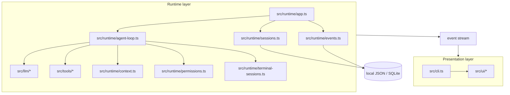
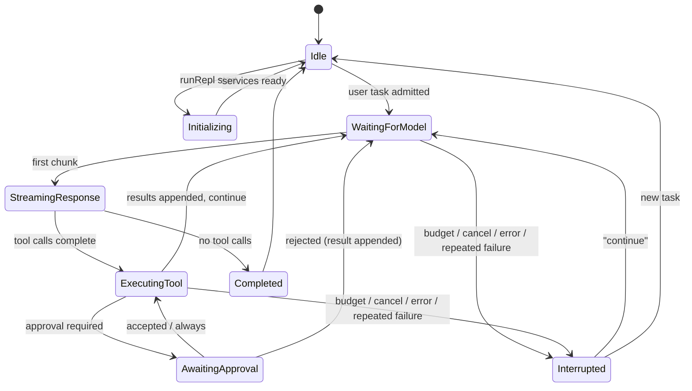
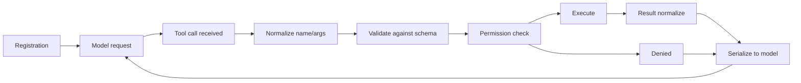

# Target Architecture — Agent-Termo

> Truthful gap analysis. Every item is marked against the ACTUAL code on
> `local-branch` HEAD `ec7e8c0`:
>
> - `implemented` — present and behaving as described in `src/`.
> - `partially implemented` — present but not at the target level of ownership/robustness.
> - `not yet implemented` — absent; a real gap, not a fiction.
>
> This document defines where the architecture should go; it does not claim the
> work is done. The design stays within Agent-Termo's existing stack (TypeScript,
> Node/Bun, OpenAI-compatible providers, local file persistence) and adds
> boundaries rather than frameworks.

## Design principles

1. One runtime, one owner per responsibility (`src/main.ts` must stop being the
   only coordinator that also talks to the UI).
2. Presentation consumes events; it never implements agent logic.
3. Provider-specific behavior is normalized at the adapter boundary.
4. Tool execution has one lifecycle and one permission boundary.
5. Sessions and task state have explicit owners and predictable transitions.
6. Cancellation propagates through every async boundary.
7. Context management is deterministic and independently testable (already true).

## Target module boundaries

| Boundary | Responsibility | Status |
|---|---|---|
| `src/runtime/app.ts` | composition root: build services, own lifecycle/shutdown | `partially implemented` — this is `runRepl` today, but it also renders UI. |
| `src/runtime/agent-loop.ts` | turn/tool loop as pure orchestration (no `print*`) | `partially implemented` — `runToolLoop` exists but calls UI directly. |
| `src/runtime/events.ts` | typed event envelope (turn/tool/usage/compaction) | `not yet implemented` — only `runtime/subagents.ts` has a subscribe API; no general bus. |
| `src/llm/*` | provider adapter + normalization | `implemented` for OpenAI-compatible + Anthropic; `partially implemented` for a formal adapter interface (provider conditionals live inside `NimClient`). |
| `src/tools/*` | tool registry + execution | `implemented` for execution; `partially implemented` for a validated registry (schemas live in `llm/tools.ts`, execution in `tools/index.ts`, no registration-time validation). |
| `src/runtime/context.ts` | budget/compaction | `implemented` (deterministic, tested). |
| `src/runtime/permissions.ts` | central permission decision | `partially implemented` — allowlist + prompts; no rule model, no sandbox. |
| `src/runtime/sessions.ts` | session ownership/persistence | `implemented` for JSON persistence; `partially implemented` for schema versioning/migrations. |
| `src/runtime/terminal-sessions.ts` | process lifecycle | `implemented` (process-tree kill, background sessions). |
| `src/ui/*` | rendering only | `partially implemented` — rendering is here, but the loop still calls it directly. |

## Execution lifecycle / state machine

Target states (only the ones Agent-Termo genuinely needs):

| State | Where it exists today | Status |
|---|---|---|
| Idle / Running / Interrupted | `TaskState.status` in `main.ts` (`'idle' | 'running' | 'interrupted'`) | `implemented` (coarse) |
| Initializing / WaitingForModel / StreamingResponse / ExecutingTool / AwaitingApproval / Completed | implicit in `runToolLoop` + `withEscapeCancellation` control flow | `partially implemented` — not named or validated states |
| Valid transitions with rejection of invalid ones | none | `not yet implemented` |
| Prevent interleaving multiple prompts in one session | single in-flight task by construction; guarded by `activeBashChild`/approval queue only | `partially implemented` |

## Tool lifecycle

| Step | Status |
|---|---|
| Registration with stable id/name/schema/handler | `partially implemented` (`TOOL_DEFINITIONS` + `TOOL_MAP`, no registration-time validation) |
| Name/argument normalization | `implemented` (`fromWireToolName`, `normalizeToolArguments`, `normalizeToolArgs`, `ARG_ALIASES`) |
| Schema validation before execution | `partially implemented` — hand-written per-tool argument checks, not schema-driven |
| Central permission check | `implemented` for command/file approval (`isCommandApprovalRequired`, `executeToolWithReview`) |
| Execution with timeout/cwd/cancel | `implemented` for bash/terminal; `not yet implemented` as a uniform contract for every tool |
| Result normalization | `implemented` (`ToolResult`, `formatToolResultForModel`) |
| Bounded retry | `implemented` (signature-keyed budget, Bug 3) |
| Failed tool cannot corrupt history/loop | `implemented` (failure appended as `Status: failure`, pause not crash) |

## Session lifecycle

| Capability | Status |
|---|---|
| Create / load latest / list / fork | `implemented` (`runtime/sessions.ts`) |
| Persist conversation incl. tool calls/results | `implemented` (JSON snapshot + JSONL archive) |
| Resume interrupted session | `implemented` (`taskState`, `buildContinueMessage`, `repairPendingToolCalls`) |
| Incomplete-turn recovery (missing tool results) | `implemented` (`repairPendingToolCalls` synthesizes a placeholder result) |
| Session isolation / no cross-session corruption | `implemented` for storage (per-session files); `partially implemented` for in-memory state (module-level maps keyed by id) |
| Schema versioning + migration | `not yet implemented` (defensive parse only) |
| Safe concurrent turns per session | `partially implemented` (single in-flight turn; no explicit lock) |

## Security boundaries

| Boundary | Status |
|---|---|
| Workspace containment (lexical + realpath, symlink escape rejection) | `implemented` (`runtime/workspace.ts`, used by every file/bash/git tool) |
| Dangerous-command blocking | `implemented` (`DANGEROUS_PATTERNS`, `rm -rf /`, `mkfs`, fork-bomb) |
| Temp-dir rejection for project files | `implemented` (`/tmp`, `$TMPDIR`, `mktemp` blocked) |
| Command/file approval prompt with per-call and persistent allow | `implemented` (`promptCommandApproval`, `allowedCommands`) |
| OS-level sandbox / restricted process | `not yet implemented` — approval controls only; documented honestly (no sandbox claim) |
| Secret handling (env keys, never logged) | `implemented` (keys read from env, `saveNimApiKey` stores only key, no logging of keys) |
| Output caps (bash/grep/glob) | `implemented` (`MAX_BASH_OUTPUT`, `MAX_GREP_MATCHES`, `MAX_RETAINED_OUTPUT`) |

## Event contract (target)

| Event | Status |
|---|---|
| Session created / turn started / completed / failed / cancelled | `not yet implemented` as events (file timeline only) |
| Assistant delta / completed | `partially implemented` (`onChunk` → `MarkdownPrinter` + `setScreenStatus`) |
| Tool call received / execution started / output / completed | `partially implemented` (`printToolCall`, `printToolResult`, terminal hooks, sub-agent monitor) |
| Permission requested / resolved | `partially implemented` (inline prompt flow, no event) |
| Token usage updated | `implemented` (`setScreenStatus({usage})`) |
| Context compacted | `implemented` (`printInfo('Context compacted…')`), no event |
| Process exited | `implemented` (terminal hooks `onEnd`) |

Envelope shape to standardize later: `{ type, id, timestamp, sessionId, turnId?, payload }`
— type-safe payloads per event, one-way from runtime to UI.

## Summary of the honest gap

What is already production-quality: context budgeting/compaction (deterministic +
tested), the tool retry budget, process-tree termination, evidence-gated
completion, path containment, and session persistence for a single-process CLI.

What is missing for the "reusable runtime + clean client" goal: (1) a typed event
contract so the UI consumes events instead of being called, (2) extraction of the
agent loop out of `main.ts` into an orchestration module with no UI dependency,
(3) explicit lifecycle states with validated transitions, (4) a rule-based
permission model, and (5) persistence schema versioning. These are sequenced in
`implementation-plan.md`.
