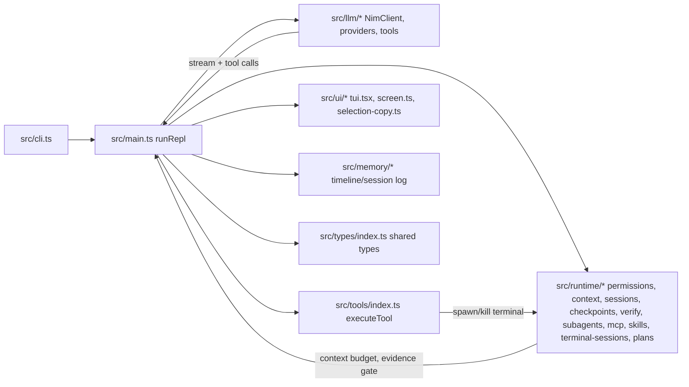

# Agent-Termo — Architecture Audit & Remediation

> Status: remediation applied and verified. This replaces the earlier PLAN.md (a
> completed "permission bar color" plan whose steps were already executed).

## Baseline (before changes)

| Check | Result |
|---|---|
| `bun run typecheck` | pass (exit 0) |
| `bun run test` | 208 passed / 2 skipped |
| `bun run build` | `dist/cli.js` built |

## Entry points

- `bin/agent-termo.js` → `dist/cli.js`
- `src/cli.ts` — commander CLI; parses args, `init`, MCP subcommands; calls `runRepl`.
- `src/main.ts` — the **live** runtime: `runRepl` REPL + `runToolLoop` agent loop.

`src/main-new.ts` + `src/core/*` were an abandoned second runtime. **Removed** (see D1).

## Current architecture

### Execution lifecycle (model/tool cycle)

1. `runRepl` loads config, custom agents, MCP, and the persisted session; builds the system prompt.
2. On a task, `runToolLoop` streams a model response and collects tool calls.
3. Tool calls are deduplicated (`dedup`), then executed — `agent:delegate` calls in
   parallel, everything else sequential to avoid write/terminal races.
4. Results are serialized for the model via `formatToolResultForModel` and appended
   as assistant→tool message pairs (OpenAI ordering).
5. The loop repeats until the model emits no tool calls; a failed-call repeat pauses
   the task instead of looping.
6. Completion is gated by `verifyCompletionWithChecks` against real evidence (files
   written, commands run) — not the model's own narration.

## Defects found & fixed

| ID | Severity | Component | Problem | Root cause | Fix | Verification |
|---|---|---|---|---|---|---|
| D1 | Critical | `src/main-new.ts`, `src/core/*` | A second, broken agent runtime existed alongside the live one: its run-loop lost streamed tool calls (`fullContent = chunk.content` overwrite), stubbed verification, and duplicated session/tool/LLM logic. Nothing imported it. | An abandoned "new architecture" migration was left in place. | Deleted the 9 orphaned files (recoverable from git history). | typecheck pass, 208 tests pass, build pass. |
| D2 | High | `PermissionMode` type | The permission type was defined in three places (`core/types.ts`, `main.ts`, `main-new.ts`), and the TUI imported it from the dead `core/` tree. | Duplicate type aliases with no single owner. | Added `PermissionMode` to `src/types/index.ts`; `tui.tsx` and `main.ts` now import it from there. | typecheck pass; `permission-colors` tests pass. |

## Requirements already satisfied (evidence)

The live runtime already implements most of NEXT_LEVEL.md's phases. Key mapping:

| Area | Where | Tests |
|---|---|---|
| Tool-call streaming/reconstruction | `src/llm/client.ts`, `dedup`/`parseToolCallsFromText` in `src/main.ts` | `tests/unit/streaming.test.ts` |
| Transient-retry + error classification (429/5xx incl. DeepSeek 503) | `isTransientError`/`withTransientRetries` in `src/main.ts` | `tests/unit/providers.test.ts` |
| Terminal process-tree termination (Windows `taskkill /t /f`, POSIX group kill) | `src/runtime/terminal-sessions.ts` | `tests/unit/terminal-sessions.test.ts` |
| Ctrl+C selection/copy vs cancellation | `src/ui/selection-copy.ts` | `tests/unit/selection-copy.test.ts` |
| Context budgeting / compaction | `src/runtime/context.ts` | `tests/unit/context.test.ts` |
| Tool-loop budget + repeated-failure pause | `src/main.ts`, `src/runtime/run-budget.ts` | `tests/unit/tool-loop-budget.test.ts` |
| Evidence-gated completion | `src/runtime/verify.ts`, `src/runtime/checks.ts` | `tests/unit/verify.test.ts` |
| File-change safety (checkpoints) | `src/runtime/checkpoints.ts` | `tests/unit/checkpoints.test.ts` |

## Remaining risks / unverified

- **Live provider integrations** (DeepSeek, OpenAI, Anthropic, etc.) were not exercised
  against real endpoints in this session — no API credentials available. Error-classification
  logic is unit-tested, not live-tested.
- **Cross-platform**: only Windows was tested here. `terminal-sessions.ts` branches on
  `process.platform`, but Linux/macOS behavior is untested in this environment.
- **Stress/long-session behavior** (memory, orphaned processes over hours) was not measured.

## Acceptance status

| Area | Status |
|---|---|
| Architecture: single runtime, no duplicate implementations | PASS (after D1/D2) |
| Tool calling / streaming | PASS (unit-tested; not live-tested) |
| Terminal lifecycle / cancellation | PASS (unit-tested on Windows) |
| Context budgeting | PASS (unit-tested) |
| Error classification | PASS (unit-tested; not live-tested) |
| Security review | PARTIAL — not re-audited this pass |
| Cross-platform | BLOCKED — Windows-only verification |
| Live provider integration | BLOCKED — no credentials |
