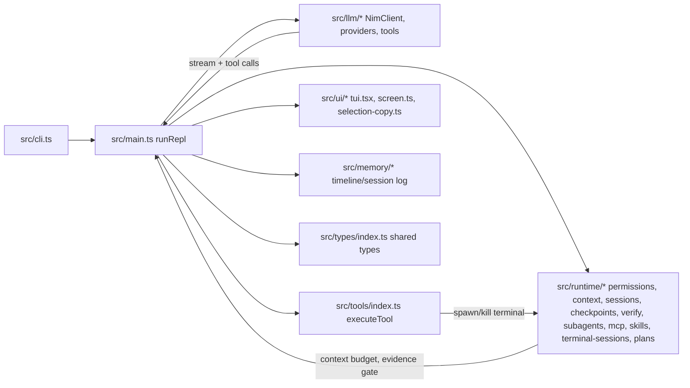

# Agent-Termo — Architecture Audit & Remediation

> Status: remediation applied and verified. This replaces the earlier PLAN.md (a
> completed "permission bar color" plan whose steps were already executed).
>
> Architecture documentation now lives under `docs/architecture/`:
>
> - `docs/architecture/architecture-comparison.md` — OpenCode vs Codex vs Agent-Termo (source-backed, reference SHAs recorded).
> - `docs/architecture/current-architecture-audit.md` — actual current architecture, execution lifecycle, root-cause findings.
> - `docs/architecture/target-architecture.md` — target design, gap analysis (implemented / partially / not yet).
> - `docs/architecture/implementation-plan.md` — phases, priorities, completed + outstanding work, risks.

## Baseline (before the 3 bug fixes)

| Check | Result |
|---|---|
| `bun run typecheck` | pass (exit 0) |
| `bun run test` | 208 passed / 2 skipped |
| `bun run build` | `dist/cli.js` built |

## Current verification (after the 3 bug fixes + regression tests)

| Check | Result |
|---|---|
| `bun run typecheck` | clean (exit 0) |
| `bun run test` | **215 passed / 2 skipped** across **31 passed + 1 skipped test file (32 total)** |

## Entry points

- `bin/agent-termo.js` → `dist/cli.js`
- `src/cli.ts` — commander CLI; parses args, `init`, MCP subcommands; calls `runRepl`.
- `src/main.ts` — the **live** runtime: `runRepl` REPL + `runToolLoop` agent loop.

`src/main-new.ts` + `src/core/*` were an abandoned second runtime. **Removed** (see D1).

## Current architecture

### Execution lifecycle (model/tool cycle)

1. `runRepl` loads config, custom agents, MCP, and the persisted session; builds the system prompt.
2. On a task, `runToolLoop` streams a model response and collects tool calls.
3. Tool calls are deduplicated (`dedup`), then executed — `agent:delegate` calls in
   parallel, everything else sequential to avoid write/terminal races.
4. Results are serialized for the model via `formatToolResultForModel` and appended
   as assistant→tool message pairs (OpenAI ordering).
5. The loop repeats until the model emits no tool calls; a failed-call repeat pauses
   the task instead of looping.
6. Completion is gated by `verifyCompletionWithChecks` against real evidence (files
   written, commands run) — not the model's own narration.

## Defects found & fixed

| ID | Severity | Component | Problem | Root cause | Fix | Verification |
|---|---|---|---|---|---|---|
| D1 | Critical | `src/main-new.ts`, `src/core/*` | A second, broken agent runtime existed alongside the live one: its run-loop lost streamed tool calls (`fullContent = chunk.content` overwrite), stubbed verification, and duplicated session/tool/LLM logic. Nothing imported it. | An abandoned "new architecture" migration was left in place. | Deleted the 9 orphaned files (recoverable from git history). | typecheck pass, 208 tests pass, build pass. |
| D2 | High | `PermissionMode` type | The permission type was defined in three places (`core/types.ts`, `main.ts`, `main-new.ts`), and the TUI imported it from the dead `core/` tree. | Duplicate type aliases with no single owner. | Added `PermissionMode` to `src/types/index.ts`; `tui.tsx` and `main.ts` now import it from there. | typecheck pass; `permission-colors` tests pass. |

## The three reliability bugs fixed this pass (commits `27f48c9` + `ec7e8c0`)

| ID | Component | Root cause | Fix | Verification |
|---|---|---|---|---|
| B1 | `src/runtime/context.ts` (caller `completeWithContextRecovery` in `src/main.ts`) | Auto-compaction triggered at 0.85 of a budget that already reserved output + safety margin, so it compacted far too early; protection of the objective/goal/failure diagnostics was ad-hoc. | Trigger is now the reserved `inputBudgetTokens`; deterministic `collectProtectedMessages` protects the system prompt, original objective, current goal, most recent tool result, and every `Status: failure` diagnostic; `shortenToolMessages` skips protected messages; the aggressive recovery path is retained. | `tests/unit/context.test.ts` regressions (premature-0.85, protected-marker verbatim, determinism) + budget-trigger / oversized-request / tool-shortening tests. |
| B2 | `src/main.ts` + `src/runtime/run-budget.ts` | Unclear/incorrect loop stopping conditions (symptom of B1 and B3). | Bounds are exactly: the 20-minute wall-clock budget, the retry budget (B3), and "model stops issuing tool calls". On budget stop, pending calls are preserved as explicit failures and the task becomes `interrupted`. | `tests/unit/tool-loop-budget.test.ts` (no model-turn count; wall-clock stop). |
| B3 | `src/main.ts` | The same failing tool call could be retried indefinitely; failure memory was shared between the gate and diagnostics. | `MAX_CONSECUTIVE_FAILURES_PER_SIGNATURE = 2`; `shouldPauseForRepeatedFailedToolCall` takes a run-scoped `Map<string, number>` and blocks at count ≥ 2; `taskState.failedToolCalls` stays a `Set` for diagnostics; `shouldClearFailedToolCalls` clears only after a successful non-read-only corrective action. | `tests/unit/retry-budget.test.ts` + `tests/integration/tool-loop.test.ts` (duplicate-call pause, unchanged-call pause, corrective retry). |

## Requirements already satisfied (evidence)

The live runtime already implements most of NEXT_LEVEL.md's phases. Key mapping:

| Area | Where | Tests |
|---|---|---|
| Tool-call streaming/reconstruction | `src/llm/client.ts`, `dedup`/`parseToolCallsFromText` in `src/main.ts` | `tests/unit/streaming.test.ts` |
| Transient-retry + error classification (429/5xx incl. DeepSeek 503) | `isTransientError`/`withTransientRetries` in `src/main.ts` | `tests/unit/providers.test.ts` |
| Terminal process-tree termination (Windows `taskkill /t /f`, POSIX group kill) | `src/runtime/terminal-sessions.ts` | `tests/unit/terminal-sessions.test.ts` |
| Ctrl+C selection/copy vs cancellation | `src/ui/selection-copy.ts` | `tests/unit/selection-copy.test.ts` |
| Context budgeting / compaction | `src/runtime/context.ts` | `tests/unit/context.test.ts` |
| Tool-loop budget + repeated-failure pause | `src/main.ts`, `src/runtime/run-budget.ts` | `tests/unit/tool-loop-budget.test.ts`, `tests/unit/retry-budget.test.ts`, `tests/integration/tool-loop.test.ts` |
| Evidence-gated completion | `src/runtime/verify.ts`, `src/runtime/checks.ts` | `tests/unit/verify.test.ts` |
| File-change safety (checkpoints) | `src/runtime/checkpoints.ts` | `tests/unit/checkpoints.test.ts` |

## Remaining risks / unverified

- **Live provider integrations** (DeepSeek, OpenAI, Anthropic, etc.) were not exercised
  against real endpoints in this session — no API credentials available. Error-classification
  logic is unit-tested, not live-tested.
- **Cross-platform**: only Windows was tested here. `terminal-sessions.ts` branches on
  `process.platform`, but Linux/macOS behavior is untested in this environment.
- **Stress/long-session behavior** (memory, orphaned processes over hours) was not measured.
- **Architecture gaps** (not bugs, not yet implemented): no typed event contract, the
  agent loop is coupled to the UI in `main.ts`, permissions are allowlist+prompts (not a
  rule model, no OS sandbox), session JSON has no schema versioning. Sequenced in
  `docs/architecture/implementation-plan.md`.

## Acceptance status

| Area | Status |
|---|---|
| Architecture: single runtime, no duplicate implementations | PASS (after D1/D2) |
| Tool calling / streaming | PASS (unit-tested; not live-tested) |
| Tool retry budget / loop bounds | PASS (B2/B3 + regression tests) |
| Context budgeting / compaction | PASS (B1 + regression tests) |
| Terminal lifecycle / cancellation | PASS (unit-tested on Windows) |
| Error classification | PASS (unit-tested; not live-tested) |
| Security review | PARTIAL — not re-audited this pass |
| Cross-platform | BLOCKED — Windows-only verification |
| Live provider integration | BLOCKED — no credentials |
